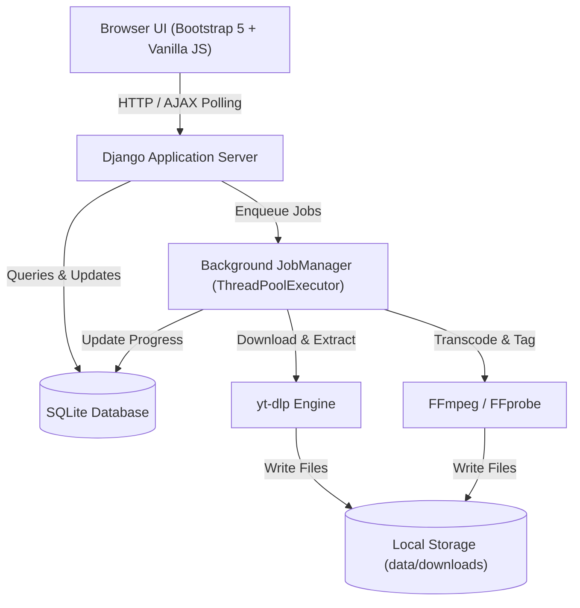

# MediaFlow 🎵

> **Local-First Media Downloader & Audio Converter** — Built with Django 5, Bootstrap 5, yt-dlp, and FFmpeg for Windows.

MediaFlow is a self-hosted, local-first web application designed for fast, high-quality audio downloads and media conversion. It runs directly on your Windows PC with a sleek dark/light interface, live job progress polling, and zero cloud lock-in.

---

## 🌟 Key Features

- **⚡ Fast URL Media Downloader**
  - Instant URL metadata inspection with preview thumbnails, title, duration, and channel.
  - High-fidelity audio extraction (MP3, M4A, FLAC, WAV, Opus).
  - Quality presets: *Best (320 kbps / lossless)*, *High (256 kbps)*, *Medium (192 kbps)*, and *Standard (128 kbps)*.
  - Embedded metadata (artist, title, album, thumbnail artwork) using mutagen & FFmpeg.

- **📑 Playlist & Batch Downloader**
  - Paste any supported playlist URL (YouTube, SoundCloud, etc.).
  - Interactive tracklist preview with individual selection checkboxes.
  - Batch download queue with item-level progress bars and status badges.

- **🔄 Local Audio Converter**
  - Drag-and-drop or browse video/audio files from your local storage.
  - Convert any media format (MP4, MKV, AVI, MOV, WEBM, FLV) to pure audio.
  - Safe transcode warnings (e.g. lossless FLAC notice when converting from lossy sources).

- **📊 Real-time Job Queue**
  - Dedicated queue dashboard with live polling (every 1.5 seconds) for downloads and conversions.
  - Detailed real-time progress indicators: percentage, download speed (e.g. `2.4 MiB/s`), and ETA.
  - Instant cancel and retry controls.

- **📚 Media Library & History**
  - Complete history of downloaded and converted files.
  - Search by title or URL with format filters.
  - Direct "Open in Explorer" button to reveal downloaded files in Windows File Explorer.
  - Safe record deletion with optional disk file cleanup.

- **⚙️ Configurable Settings & System Status**
  - Customize download folder destination and filename templates (e.g. `%(uploader)s - %(title)s.%(ext)s`).
  - Set maximum concurrent background worker jobs.
  - One-click yt-dlp auto-updater to keep up with streaming platform changes.
  - Live FFmpeg & FFprobe binary health check.
  - Instant Dark / Light theme toggle.

---

## 🏗️ Architecture



---

## 🚀 Quick Start (Windows)

### Prerequisites

1. **Python 3.12+** (ensure `python` or `uv` is in your PATH).
2. **FFmpeg & FFprobe**: Included directly in the project (`bin/ffmpeg.exe` and `bin/ffprobe.exe`). No system-wide installation or global PATH modifications required!

### 1. One-Click Setup

Double-click `setup.bat` or run:
```cmd
setup.bat
```
This script will:
- Detect or create the `.venv` virtual environment.
- Install dependencies using `uv` or `pip`.
- Initialize the `.env` configuration file.
- Apply SQLite database migrations.
- Verify FFmpeg availability.
- Create a desktop shortcut (`MediaFlow.lnk`).

### 2. Launch the Application

Double-click `start.bat` or the **MediaFlow** shortcut on your Desktop.
- Automatically launches the Django local server on `http://127.0.0.1:8000`.
- Automatically opens your default web browser to the dashboard.
- Press `Ctrl+C` in the command window to stop.

---

## 🛠️ Manual Installation (Developers)

```cmd
# 1. Clone repository and navigate inside
cd audio-downloader

# 2. Create virtual environment and install dependencies
uv sync
# Or with standard pip:
# python -m venv .venv
# .venv\Scripts\pip install -e .

# 3. Create .env from template
copy .env.example .env

# 4. Run migrations
uv run python manage.py migrate

# 5. Run tests
uv run pytest

# 6. Start server
uv run python manage.py runserver 127.0.0.1:8000
```

---

## ⚙️ Configuration (`.env`)

You can customize runtime behavior in `.env`:

| Variable | Default | Description |
| :--- | :--- | :--- |
| `DJANGO_DEBUG` | `True` | Set to `False` for production local mode |
| `DEFAULT_DOWNLOAD_DIR` | `data/downloads` | Default destination for downloaded files |
| `MAX_CONCURRENT_JOBS` | `3` | Maximum concurrent background tasks |
| `DEFAULT_AUDIO_FORMAT` | `mp3` | Default format (`mp3`, `m4a`, `flac`, `wav`, `opus`) |
| `DEFAULT_AUDIO_QUALITY` | `high` | Default preset (`best`, `high`, `medium`, `low`) |
| `FFMPEG_PATH` | `ffmpeg` | Path or command name for FFmpeg |
| `FFPROBE_PATH` | `ffprobe` | Path or command name for FFprobe |
| `DEFAULT_THEME` | `dark` | Initial UI theme (`dark` or `light`) |
| `SPOTIFY_CLIENT_ID` | `""` | Optional Spotify API Client ID |
| `SPOTIFY_CLIENT_SECRET`| `""` | Optional Spotify API Client Secret |

---

## 🔒 Security & Local-First Guardrails

- **SSRF Protection:** URL validation strictly prohibits local loopback addresses (`127.0.0.1`, `localhost`) and private RFC-1918 subnets (`192.168.0.0/16`, `10.0.0.0/8`).
- **Path Traversal Prevention:** All output filenames are sanitized against Windows forbidden characters (`<>:"/\|?*`) and checked to strictly remain inside approved directories.
- **Subprocess Safety:** All calls to `ffmpeg` and `yt-dlp` use parameterized argument lists — never raw shell string interpolation.
- **Thread Safety:** Database updates from background worker threads use atomic transactions and threading locks to prevent SQLite locking conflicts.

---

## 🧪 Running Tests

The test suite includes 40 unit and integration tests covering models, validators, file utilities, workers, services, and views:

```cmd
uv run pytest
```

---

## 📄 License

MIT License. Designed and built for personal local-first media management.
